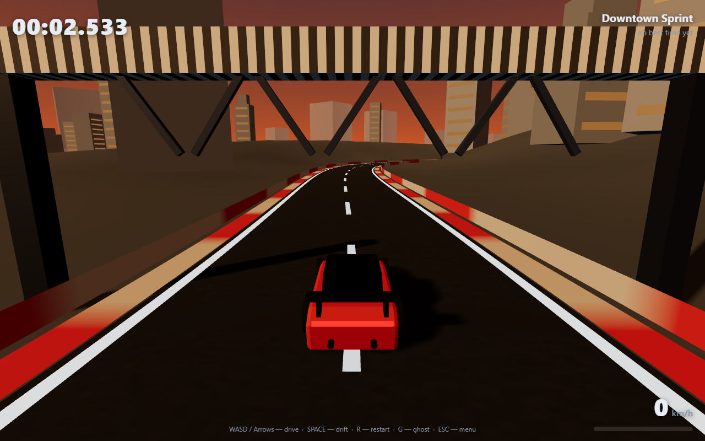
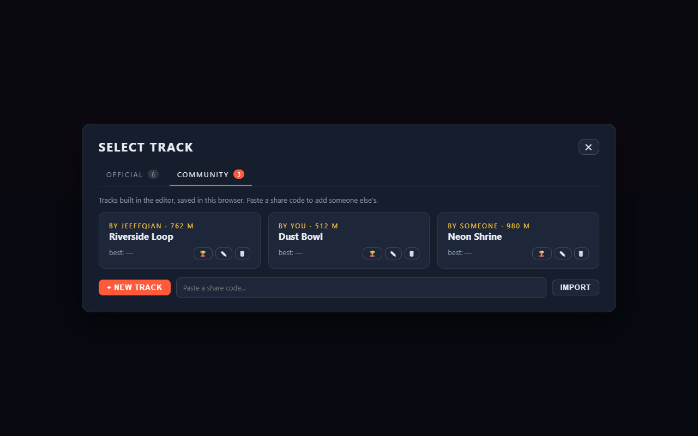

# PolyDash 🏎️

A low-poly, time-trial drift racing game that runs in your browser. Built with Three.js — no build step required.



  

## Features

- **Two track sections** — `OFFICIAL` (the 6 built-in circuits) and `COMMUNITY` (tracks you and other players build in the editor).
- **Community tracks sync across devices** — tracks saved in the editor are published to the shared cloud library, so a layout built on one computer shows up on every other device (☁ badge). Share codes still work for sending a single track.
- **6 official tracks** across 6 themed environments — meadow, desert, snow, sunset city, neon nights and volcano rim, each with its own palette, lighting and decorations.
- **Drift physics** — hold SPACE to slide through corners; drifting charges a boost meter that rewards you with extra speed when you exit the drift.
- **Ghost replay** — your best lap is recorded turn-by-turn; race against your own translucent ghost on every track.
- **Checkpoint splits & medals** — 3 checkpoint splits per lap, plus gold / silver / bronze target times for every track.
- **Online leaderboard** — global top-10 per track, backed by a managed cloud database. Submit your time after each lap.
- **Track editor** — build your own layouts on a grid, test drive them instantly, save them to the community list and share them with a code.
- **Local best times** — saved in your browser, shown per track.

## Official vs Community



| | Official | Community |
|---|---|---|
| Where it lives | `js/tracks.js` | your browser's `localStorage` |
| How to add one | edit the source | build it in the editor, or paste a share code |
| Best time & ghost | yes | yes (keyed by track shape) |
| Leaderboard | yes | yes — a shared code produces the same track id, so everyone racing that code shares one board |

**Saving a track:** `TRACK EDITOR` → drop corners → type a name → `SAVE`. It appears under `PLAY → COMMUNITY`, where each card can be played, edited (✎) or deleted (🗑).

**Sharing a track:** open it in the editor and press `EXPORT` — the code is copied to your clipboard. Anyone can paste it into `PLAY → COMMUNITY → IMPORT` and race the exact same layout.

## Controls

| Key | Action |
|---|---|
| `W` / `↑` | Throttle |
| `S` / `↓` | Brake / reverse |
| `A` `D` / `←` `→` | Steer |
| `Space` | Drift (charges boost) |
| `R` | Restart |
| `G` | Toggle ghost |
| `Esc` | Back to menu |

## Run locally

Any static file server works. For example:

```bash
npx serve .        # or: python -m http.server 8080
```

Then open the printed URL in your browser. (Opening `index.html` directly via `file://` also works in most browsers.)

## Notes on hosting

**Playable build with the online leaderboard:** https://polydash-game.app.workbuddy.host/?sharecode=RIRHYZ7NMN

The game is a static site, so it runs anywhere — including GitHub Pages (`https://jeeffqian.github.io/polydash/`, code mirror). The **online leaderboard** and the **shared community-track library** only answer the domain the backend was provisioned for (`polydash-game.app.workbuddy.host`) and localhost. On any other host they are skipped and the game falls back to local best times, ghosts and a browser-local track list. Everything else (tracks, physics, editor, racing) works identically. Set `localStorage.polydash_cloud_off = '1'` to force that local-only mode on any host (the smoke test does this so it never writes to the live database).

## Tests

Headless logic + physics tests (no browser needed):

```bash
npm install
npm test
```

The physics suite drives a full lap on every official track with a simple AI and asserts: lap completion, no NaN states, wall containment and drift-grip behavior.

## Tech notes

- **Rendering**: Three.js (ES module via CDN import map), PCF soft shadows, per-theme fog & lighting.
- **Physics**: custom arcade model — forward/lateral velocity decomposition, grip-based lateral decay, drift charge → boost, gravity + terrain-following with crest launches, wall projection with speed penalty.
- **Tracks**: closed Catmull-Rom splines sampled into road/curb ribbons, instanced barriers, procedurally scattered theme decorations.
- **Backend**: WorkBuddy Cloud database (`leaderboard` table: `track_id`, `player_name`, `time_ms`) with public read / validated insert policies.
- **Ghost data**: stored in `localStorage` at ~30 Hz, interpolated on playback.

## Project layout

```
index.html          entry page (import map + UI markup)
css/style.css       UI styling
js/config.js        cloud service public config
js/main.js          menus, track select tabs, finish flow
js/game.js          game loop, camera, states, HUD
js/car.js           car physics + model
js/tracks.js        official track definitions + 3D track builder
js/timing.js        checkpoints, lap timing
js/ghost.js         ghost recorder/replayer
js/leaderboard.js   cloud leaderboard client
js/editor.js        track editor
js/community.js     community track library + share codes
test/               headless logic, physics & browser tests
```

## License

MIT
